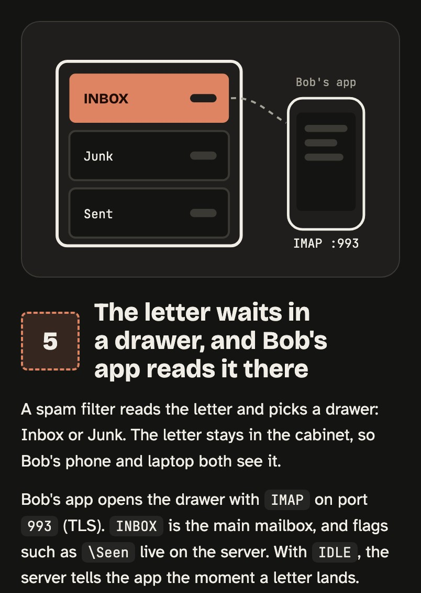

# kiss

ELI5 for engineers. Explain any tech topic or codebase as one visual HTML page: the whole route first, then a drawing per step with the real names.


```
/kiss how CORS works
/kiss deep how CORS works
/kiss simple how CORS works
/kiss how our auth middleware works
/kiss polling or websockets?
```

**Zoom, don't simplify.** You get one page with:

- **The trace and the route.** One concrete example in two sentences, then every stop it makes, in order.
- **One stamped step per stop.** A big flat drawing on the left. On the right, what happens in plain words, then the real names.
- **One orange thing per drawing.** The part that decides.
- **A why step** when the design choice is the surprising part.
- **An honest end box.** The catch, the questions to ask next, what was simplified, the sources, and anything not verified.

## Depth

Simple means fewer ideas, never wrong ones. Pick how far down you go:

| | Reader | What changes |
|---|---|---|
| `simple` | new to the field | 3–4 steps in plain words. No code. |
| default | a developer new to the topic | 4–6 steps with the real names, each with a short "under the hood". |
| `deep` | an engineer who wants the internals | 6–8 steps plus a why step: failure modes, real numbers, requests and code. |


Ask about code in your project and it reads the code first, then uses the real file and function names.

The page is a single HTML file in Claude's palette (black ink, warm greys, one orange): no framework, light and dark mode, phone-friendly. If your Claude can publish artifacts, it publishes one. Otherwise it saves `kiss-<topic>.html`.

The skill ships a reference page, [`skills/kiss/example.html`](https://eranltd.github.io/kiss/skills/kiss/example.html) (how an email reaches an inbox), that sets the drawing bar for every run.

See [examples/](https://github.com/eranltd/kiss/tree/gh-pages/examples): CORS at two depths ([`how-cors-works.html`](https://eranltd.github.io/kiss/examples/how-cors-works.html), [`how-cors-works-deep.html`](https://eranltd.github.io/kiss/examples/how-cors-works-deep.html)), Raft consensus ([`how-raft-works.html`](https://eranltd.github.io/kiss/examples/how-raft-works.html)), Google One Tap ([`how-google-one-tap-works.html`](https://eranltd.github.io/kiss/examples/how-google-one-tap-works.html)), DNS ([`how-dns-works.html`](https://eranltd.github.io/kiss/examples/how-dns-works.html)), and one read from real code: how Express routes a request, traced through Express 5's own source ([`how-express-routes-a-request.html`](https://eranltd.github.io/kiss/examples/how-express-routes-a-request.html)).



## Install

```
/plugin marketplace add eranltd/claude-plugins
/plugin install kiss@eranltd
```

That marketplace also lists [pixel-pet](https://github.com/eranltd/pixel-pet). To add this repo on its own instead: `/plugin marketplace add eranltd/kiss`, then `/plugin install kiss@kiss`.

## Why not ELI5?

ELI5 talks to a five-year-old. `kiss` talks to someone who studied this stuff and is new to this one topic: few words and big pictures, but it keeps the real terms, shows the mechanism, and points at where it lives in the code.

## Data and privacy

`kiss` reads files in the open project only when the topic is about project code. It writes one HTML file to the current folder, or publishes it as an artifact where the app supports that. The generated page loads its fonts from Google Fonts (`fonts.googleapis.com` and `fonts.gstatic.com`), so opening the page contacts Google. The plugin sends nothing anywhere else.

## License

MIT
