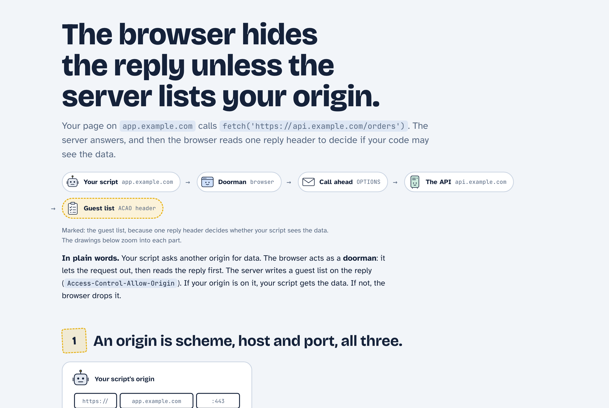
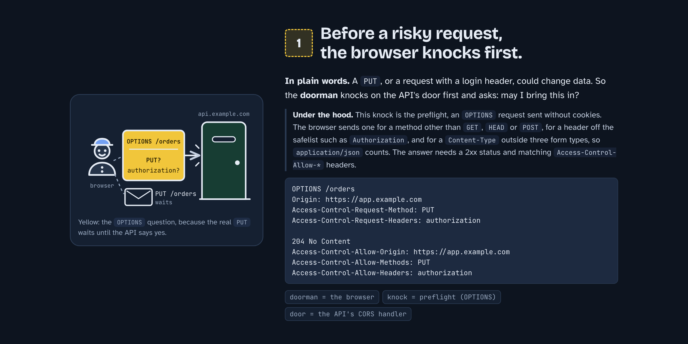
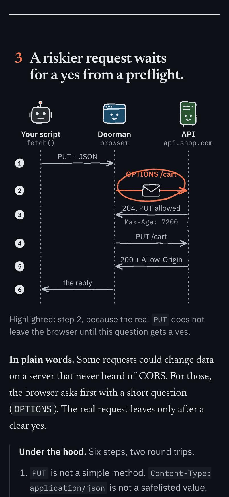
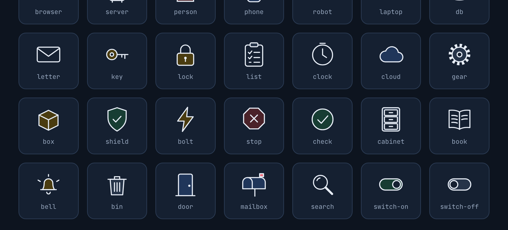

# kiss

Keep it simple. Explain any tech topic to a developer as one plain HTML page.



```
/kiss how CORS works
/kiss deep how CORS works
/kiss simple how CORS works
/kiss how our auth middleware works
/kiss polling or websockets?
```

**Zoom, don't simplify.** You get one page with:

- **The answer in the title.** You get it in five seconds.
- **The whole thing at a glance.** One drawing of the full flow, in plain words.
- **Zooms into each box.** Drawings with the real names, the step that matters highlighted, then the same idea "in plain words".
- **The catch.** The one thing that bites people.
- **Push further.** The questions a sharp reader asks next, with short answers behind a click.
- **An honest footer.** What was simplified, the sources, and where it lives in your code.

## Depth

Simple means fewer ideas, never wrong ones. Pick how far down you go:

| | Reader | What changes |
|---|---|---|
| `simple` | new to the field | 2–3 zooms in plain words. No code. |
| default | a developer new to the topic | 3–5 zooms with real names, each with a short "Under the hood". |
| `deep` | an engineer who wants the internals | Sequence diagrams and state machines, failure modes, real numbers, real code. |



Ask about code in your project and it reads the code first, then uses the real file and function names.

The page is a single HTML file: no framework, light and dark mode, phone-friendly. If your Claude can publish artifacts, it publishes one. Otherwise it saves `kiss-<topic>.html`.

See [examples/](examples/) for the same topic at two depths: [`how-cors-works.html`](examples/how-cors-works.html) and [`how-cors-works-deep.html`](examples/how-cors-works-deep.html).



Every page draws with the same cast of hand-drawn characters, so you remember pictures, not boxes.



## Install

```
/plugin marketplace add eranltd/claude-plugins
/plugin install kiss@eranltd
```

That marketplace also lists [pixel-pet](https://github.com/eranltd/pixel-pet). To add this repo on its own instead: `/plugin marketplace add eranltd/kiss`, then `/plugin install kiss@kiss`.

## Why not ELI5?

ELI5 talks to a five-year-old. `kiss` talks to someone who studied this stuff and is new to this one topic: few words and big pictures, but it keeps the real terms, shows the mechanism, and points at where it lives in the code.

## License

MIT
